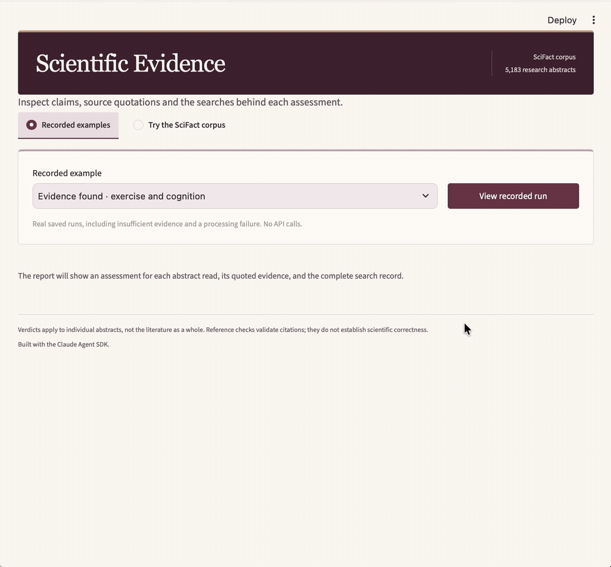
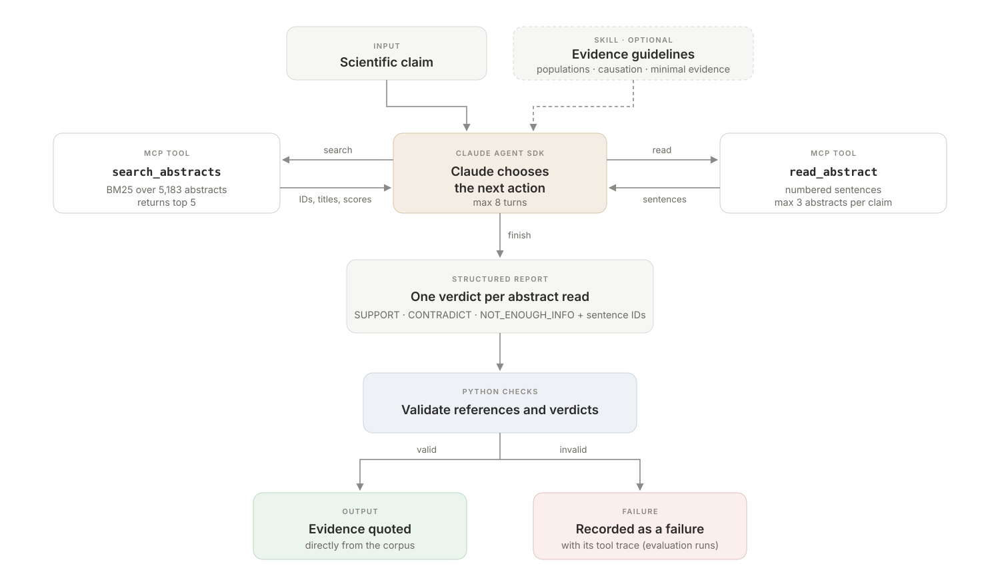

# Scientific Evidence Agent

An agent that checks scientific claims against **5,183 research abstracts from SciFact**. Built with the Claude Agent SDK, it chooses searches, reads up to three abstracts and returns a verdict for each. Python validates document and sentence references, then copies evidence quotes directly from the corpus.

**Evaluation:** Compared four configurations on 60 previously unused SciFact dev claims, with two repetitions each. Sonnet with hybrid retrieval had the highest observed F1 scores; hybrid retrieval lowered Haiku's evidence F1 on this sample. [Results and methods](docs/final_evaluation.md).

*Recorded evaluation run; playback edited for readability.*

## Why I built this

I’m interested in how language models can help people work with scientific evidence. I built this project to learn the Claude Agent SDK and test whether evidence guidelines make an agent’s answers more reliable. I wanted to check whether it could find the right evidence and recognise when the available text was insufficient. I developed it step by step, adding search tools, reference checks and evaluations.

## How it works

1. **Search:** Claude calls a BM25 keyword search over paper titles and abstracts.
2. **Read:** It selects up to three abstracts and receives their numbered sentences.
3. **Assess:** It returns `SUPPORT`, `CONTRADICT` or `NOT_ENOUGH_INFO` for each abstract.
4. **Validate:** Python checks the document references, sentence IDs and verdict/evidence consistency.
5. **Quote:** Evidence text is copied from the corpus using the validated sentence IDs.

The tools run through an **in-process MCP server**, which lets the agent call Python functions. A [Skill](.claude/skills/scientific-evidence/SKILL.md) supplies reusable instructions about study populations, causation, numerical findings and evidence sufficiency.

Verdicts apply to individual abstracts; the agent does not produce a consensus judgement across the literature.

## Example runs

These examples show a successful evidence lookup and a retrieval failure from the [saved guideline comparison](results/confirmation_20261108_235629_639604.json), using the `minimal` condition.

### Success: finding evidence and preserving study context

**Claim 218:** “CX3CR1 on the Th2 cells promotes airway inflammation.”

Claude chose two searches:

1. `CX3CR1 Th2 cells airway inflammation`
2. `CX3CR1 T helper 2 asthma allergic airway`

It read one abstract: **21366394**, *CX3CR1 is required for airway inflammation by promoting T helper cell survival and maintenance in inflamed lung*.

**Verdict:** `SUPPORT`, citing sentences 3 and 4.

Exact evidence from the corpus:

> [3] Transfer of WT CD4(+) T cells into CX3CR1-deficient mice restored the cardinal features of asthma, and CX3CR1-blocking reagents prevented airway inflammation in CX3CR1-deficient recipients injected with WT T(H)2 cells.

> [4] We found that CX3CR1 signaling promoted T(H)2 survival in the inflamed lungs, and injection of B cell leukemia/lymphoma-2 protein (BCl-2)-transduced CX3CR1-deficient T(H)2 cells into CX3CR1-deficient mice restored asthma.

The agent recovered the annotated paper and verdict. Its explanation noted that this is a mouse study, not a human study.

### Failure: missing the annotated paper

**Claim 1110:** “Suboptimal nutrition is not predictive of chronic disease”

Claude tried three searches:

1. `suboptimal nutrition predictive of chronic disease`
2. `poor diet quality associated with risk of chronic disease`
3. `diet nutrition risk of cardiovascular disease cancer cohort`

It read three abstracts:

| Document | Topic | Agent verdict |
|---|---|---|
| 12810152 | Folate, vitamin B6 and coronary heart disease | `CONTRADICT` |
| 44624045 | Vegetarian diets and ischemic heart disease | `NOT_ENOUGH_INFO` |
| 10010651 | Nutrition guidelines for cancer survivors | `NOT_ENOUGH_INFO` |

The SciFact-annotated paper, **13770184**, never appeared in the returned search results. The agent therefore missed the annotated source despite reformulating its query.

This demonstrates a retrieval failure against the benchmark. Vocabulary mismatch is a possible explanation, but the trace alone does not establish the cause. Finding other relevant papers also does not establish that they justify the full claim.

## Setup

Tested on macOS with **Python 3.13.2**. The default agent uses
`claude-haiku-5-5`; the evaluation also used `claude-sonnet-5-5`.
Running requires an Anthropic API key with access to the requested model
and incurs API charges.

From the repository root:

~~~bash
python3 -m venv .venv
source .venv/bin/activate
python -m pip install -r requirements.txt
cp .env.example .env
~~~

Add your API key to the local `.env` file. Git ignores this file.

Download the dataset using the [SciFact maintainers' download](https://github.com/allenai/scifact#dataset). Skip this step if the data is already present:

~~~bash
curl -fL --retry 2 https://scifact.s3-us-west-2.amazonaws.com/release/latest/data.tar.gz -o scifact-data.tar.gz
tar -xzf scifact-data.tar.gz
rm scifact-data.tar.gz
~~~

The project expects `data/corpus.jsonl`, `data/claims_train.jsonl` and `data/claims_dev.jsonl`. The dataset is downloaded separately and is not committed.

Check the data and run the test suite without API calls:

~~~bash
python inspect_data.py
python -m unittest discover -s tests -v
~~~

The unit tests also run without downloading SciFact; GitHub Actions runs them on Python 3.13. Corpus loading and BM25 indexing happen only when first needed.

## Run the agent

Run the built-in example:

~~~bash
python agent.py --skill on
~~~

The output includes search/read activity, a structured report, exact evidence quotations and an estimated API cost. To disable the guidelines, use `--skill off`.

To check another claim:

~~~python
import asyncio
from agent import main

report = asyncio.run(
    main(claim="CX3CR1 on the Th2 cells promotes airway inflammation.")
)
~~~

## Interactive demo

~~~bash
python -m streamlit run app.py
~~~

The app opens on **Recorded examples**, which need no API key or dataset.
**Try the SciFact corpus** runs the default BM25 Haiku agent using your local
`.env` key and corpus. It includes sample claims and searches only the fixed
abstract collection, not the web. Reports show exact quotes and search history.

## Evaluation

60 previously unused dev claims, balanced across three classes, with two
repetitions per configuration: 480 attempts in total.

| Configuration | Evidence F1 | Document/verdict F1 | NEI false flags | SDK-estimated cost (USD) |
| --- | ---: | ---: | ---: | ---: |
| Haiku · BM25 | 0.457 | 0.586 | 5/40 | $0.13 |
| Haiku · hybrid | 0.396 | 0.558 | 8/40 | $0.14 |
| Sonnet · hybrid | 0.492 | 0.701 | 7/40 | $1.59 |
| Fixed pipeline · hybrid | 0.437 | 0.644 | 7/40 | $0.18 |

Costs are totals for 120 attempts per configuration. Sonnet cost about
12 times as much as BM25 Haiku, based on the unrounded SDK estimates.

Hybrid combines BM25 with E5 embeddings. The pipeline supplies its top
three abstracts to Haiku through the same SDK and assessment guidelines.
A false flag means at least one `SUPPORT` or `CONTRADICT` assessment on a
gold `NOT_ENOUGH_INFO` claim.

Hybrid lowered Haiku's evidence F1 by 0.061 (adjusted interval
[-0.117, -0.011]); its training gains did not carry over to this dev sample.
Sonnet had the highest observed F1 scores, but no planned comparison met
the frozen rule for improvement on both F1 metrics after adjustment for
multiple comparisons. The default remains BM25 Haiku.

[Final analysis and confidence intervals](docs/final_evaluation.md)
· [Training results](results/agent_retrieval_training.json)
· [Earlier guideline experiments](docs/evaluation.md)

## Limitations

- Keyword search can miss relevant papers, and the three-abstract limit restricts coverage. The corpus contains abstracts, not full papers or a live literature search.
- Evaluation samples are small and drawn from development data. Different claim IDs can still share papers or topics.
- Agreement with dataset annotations does not guarantee a scientifically sound interpretation. Valid citations also do not establish that an explanation supports its verdict.
- The evidence-removal diagnostic covers three selected examples, so the results do not establish reliability across other claims.

## Main files

| File | Purpose |
|---|---|
| [agent.py](agent.py) | Agent loop, tool wrappers and output validation |
| [app.py](app.py) and [demo.py](demo.py) | Streamlit interface and live/recorded report adapter |
| [corpus_tools.py](corpus_tools.py) | Abstract search and reading |
| [hybrid_retrieval.py](hybrid_retrieval.py) | BM25 and E5 hybrid retrieval |
| [Skill instructions](.claude/skills/scientific-evidence/SKILL.md) | Scientific evidence guidelines |
| [scoring.py](scoring.py) and [tests](tests/) | Evaluation rules and scoring tests |
| [Experiment index](experiments/README.md) | Evaluation runners, development history and frozen reproduction instructions |
| [results](results/) | Saved experimental outputs |

## References

- Wadden et al. (2020), [Fact or Fiction: Verifying Scientific Claims](https://aclanthology.org/2020.emnlp-main.609/).
- [SciFact data, documentation and terms](https://github.com/allenai/scifact).
- [SciFact reference evaluator](https://github.com/allenai/scifact-evaluator).
- [Claude Agent SDK documentation](https://code.claude.com/docs/en/agent-sdk/overview).
